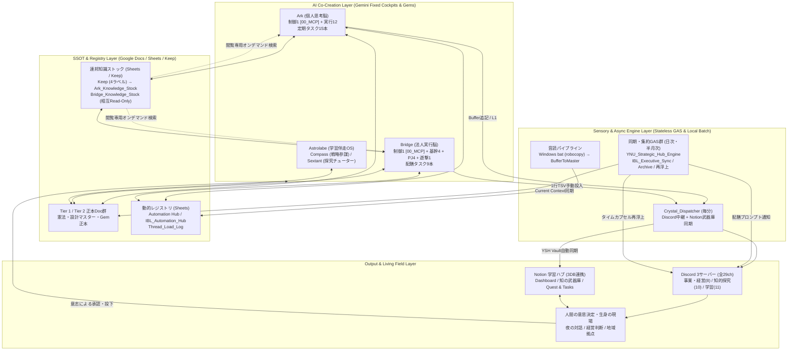
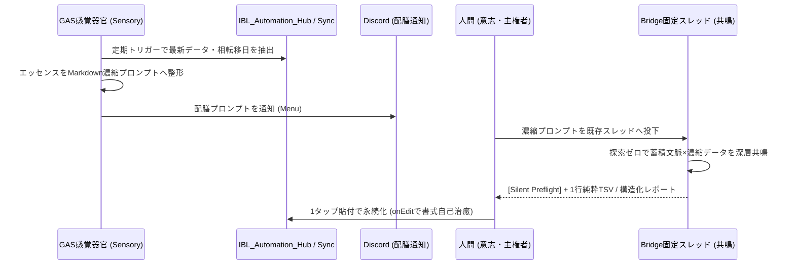
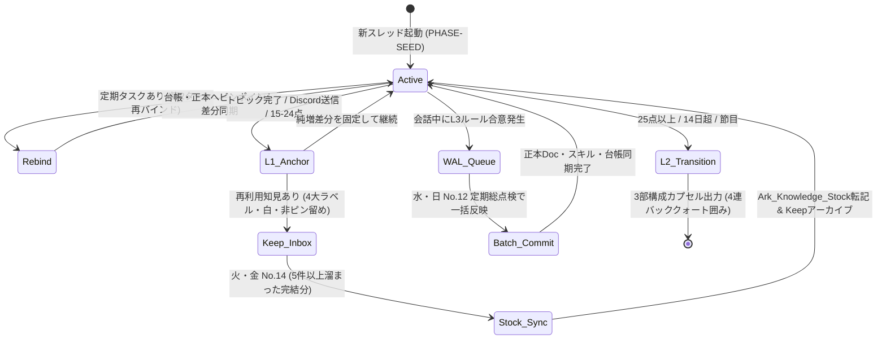

# Ark / Bridge / Astrolabe 三位一体知性生態系：アーキテクチャ設計・機構解析仕様書

**文書種別**: システムアーキテクチャ・機構解析仕様書（外部公開・専門レビュー用一般化版）  
**対象バージョン**: 2026年11月稼働設計準拠（個人OS `Ark` / 法人OS `Bridge v2.16.12` / 学習OS `Astrolabe`）  
**プライバシー処理**: 一般公表・技術解析を前提とし、個人情報・個別ファイルID・認証情報・固有名詞の一部は構造を損なわない範囲で抽象化表記（`<ID>`、`[学習者]`、`[共同創業者]` 等）としている。

---

## 1. エグゼクティブ・アーキテクチャ概要

本システムは、**「個人の思索（Ark）」「法人の実務執行（Bridge）」「次世代の自律学習（Astrolabe）」**という性質の異なる3つの知性領域を、専用SaaSへの囲い込みを行わず、**Google Workspace・Google Apps Script (GAS)・Notion・Discord・Gemini** という汎用基盤の上に疎結合で統合した認知外骨格（Cognitive Exoskeleton）である。

最大の設計特徴は、**「AIの自律探索によるトークン爆発とブラックボックス化」を構造的に排し、「感覚器官＝GAS／意志＝人間／共鳴＝AI」の三権分立（しらす型アーキテクチャ）と半透明性（Thin Glass Architecture）を貫徹している点**にある。

### 1.1 全体システムトポロジー



### 1.2 3大OSの責務・境界・接続プロトコル比較

| 属性 | Ark（個人思考脳） | Bridge（法人実行脳） | Astrolabe（学習伴走OS） |
| :--- | :--- | :--- | :--- |
| **思考ループ上の役割** | 外側ループ（Why / What）：思想、探究、身体性、個人財務、生態系全体の統治 | 内側ループ（How / When）：契約、法人ガバナンス、地域拠点開発、伴走実務 | 次世代自律ループ：学習者の自己統治（一人称PM化）と本質的理解の獲得 |
| **実行環境** | 個人Google Workspace / Gemini | 法人Google Workspace / Gemini | 学習者向けGemini Gem（2体）＋Notion＋Discord |
| **スレッド構造** | 制御1＋実行12＝**計13コックピット** | 制御1＋基幹4＋PJ4＋遊撃1＝**計10コックピット** | 専任AI 2体（**Compass** / **Sextant**）＋保護者側コックピット `[04_YSH]` |
| **定期タスク駆動方式** | Gemini定期スケジュール（15本）＋GAS（10本） | **しらす型配膳**（GASが抽出→Discord通知→人間が投下。Gemini標準定期実行は不使用） | 毎朝GAS配信（6:00）＋夜間Notion同期（0:00）＋週次PDF分析（土21:00） |
| **知識代謝ルート** | 2段階代謝：Keep（4ラベル一次保存）→ 週2回棚卸しで `Ark_Knowledge_Stock` へ集約 | **1段階代謝**：Keepバイパス（法人環境制約）→ 7列単一TSVを `Bridge_Knowledge_Stock` へ直接貼付 | 5段階自立学習サイクル → Discord Vault（10教科）→ Notion『知の武器庫』自動同期 |
| **越境プロトコル** | Bridgeストックを閲覧専用でオンデマンド検索。思想をBridgeへ供給 | Arkの提案に対し**アーキテクチャ検疫**を実施後、実務へ翻訳。個人データとは完全遮断 | 大人向けch（B&PH/IC）と完全分離。誤爆防止ガードにより指定時のみYSHへ送信 |

---

## 2. 制御プレーン＆実行プレーン：全23コックピット構造仕様

単一スレッドの肥大化によるアテンション劣化・文脈汚染（引力汚染）を防ぐため、役割ごとに固定ネームスペースを割り当てる **Hub & Spoke（分散実行）アーキテクチャ**を採用している。

### 2.1 Ark（個人思考脳）：全13コックピット仕様

| 記号 | 役割・ドメイン | 紐づく定期タスク（Ark側） | 代謝・L1/L2ポリシー |
| :--- | :--- | :--- | :--- |
| `[00_MCP]` | **上位制御プレーン**：シナプス統治・正本監査・GAS保守・負荷監視 | No.10（四半期レビュー）, No.12（水日8時総点検）, No.14（火金10時ヒアリング）, No.16（四半期FBアーカイブ）, No.17（金8時負荷記録） | 2段階WALによるL3一括コミット権限。L2時は5本の定期タスク再バインド必須 |
| `[01_IBL]` | 法人経営伴走・地域拠点構想（個人側視点の戦略壁打ち） | No.4（火金12時 IBLエグゼクティブ・ブリーフィング） | `IBL_Executive_Sync`（A2）を単一ソース参照。BFU・個人案件は除外 |
| `[02_BFU]` | 外部事業伴走・経営管理（重点3PJ＋並行検討案件） | No.1（火金12時 事業進捗整理＆パートナー共有ドラフト） | シングル・フェッチ＆二層出力（対話余白を保つ3点構成深掘り） |
| `[03_FIN]` | 個人事業・公私統合会計管理（freee連携） | No.5（毎月10日9時 経費精算）, No.6（毎月末9時 月次締め） | 68ルール（自動33＋確認35）の引き算型会計。月次記帳1時間圏内目標 |
| `[04_YSH]` | 学習伴走コックピット（保護者・技術顧問側コントロール） | No.2（土21時 週次学習レポート＆A4見開き2p PDF）, No.3（毎朝8時 Compass点検）, No.11（毎朝4時 Notionスクショ案内） | `YNU_Current_Context` および日次ログを参照。YSH誤爆防止厳守 |
| `[05_VOX]` | 多言語音読解析セッション（英語・スペイン語） | No.7（3,6,9,12月30日9時 四半期音読解析レポート） | **定型フォーマット維持枠**：15〜24点帯でもL1不要、必要時のみL2 |
| `[06_TRN]` | 英西語継続音読トレーニング | No.13（毎朝3時 ゼロツール英西並列散文生成） | **定型フォーマット維持枠**：L1不要、外部ツール不使用の軽量実行 |
| `[07_LIN]` | 言語学・語学構造の学術的比較探究 | なし（オンデマンド探究） | 通常代謝（L1/L2標準判定） |
| `[09_CUR]` | 日々の知的探究キュレーション（数理・語学・人文＋過去共鳴） | No.8（毎朝4時 3分野対等並立＋12年アーカイブ共鳴配信） | **定型フォーマット維持枠**：1,300〜1,900字凝縮、インデックスDocのみ参照 |
| `[10_SCI]` | 数理・自然科学・システム工学の自学探究 | なし（定期タスクなしのためL2時のMCP通知不要） | 公式暗記より基礎定義からの自力導出を重視 |
| `[11_HUM]` | 人文科学・日本精神史・現象学・地政学探究 | なし | 通常代謝 |
| `[12_LAB]` | 共創OS・事業の種・Invention Lab（社会実装R&D） | No.9（毎週水4時 共創OS・越境インサイト配信） | ゼロツール配信。Thin Glass / 90日ブートローダー等の設計震源地 |
| `[13_GEN]` | 日常実務・汎用オペレーション・遊撃タスク | なし（L2時のMCP通知不要） | ノイズ吸収バッファ。他専門コックピットの文脈純度を保護 |

### 2.2 Bridge（法人実行脳）：全10コックピット番台構造

法人環境では番台区分により、制御（00番台）・基幹機能（10番台）・個別プロジェクト（20番台）・遊撃（90番台）を明確に分離している。

| 番台・記号 | 役割・ドメイン | 管轄タスク・資産 |
| :--- | :--- | :--- |
| `00番台` `[00_MCP]` | 制御・統括（憲法・台帳・GAS三位一体統治） | No.00（月次OS整合監査）, No.1（三位一体統治）, No.2（代謝スキャン）, No.3（Arkサルベージ）, No.6（Discord中継）, No.9（Webhook同期） |
| `10番台` `[11_BIZ]` | 経営企画・事業構想 | `IBL_Executive_Sync` 管轄 / No.10（週次経営・実務アクションダイジェスト） |
| `10番台` `[12_FIN]` | 経理・財務 | No.4（期中freee監査）, No.14（決算・期首期末・公私黄金境界線防衛） |
| `10番台` `[13_HRM]` | 人事・労務 | 労務基盤・業務委託設計 |
| `10番台` `[14_LGL]` | 法務・登記 | 法務・コンプライアンス・契約境界 |
| `20番台` `[21_PJ-KMK]`〜`[24_PJ-KSM]` | 地域拠点・分散型宿泊・文化プロジェクト群（4スレッド） | 拠点整備・地域共創・アルベルゴ・ディフーゾ各案件の独立推進 |
| `90番台` `[99_TMP]` | 日常実務・遊撃 | 単発タスクのノイズ吸収 |

### 2.3 Astrolabe（次世代学習OS）の二体専任AI・5段階サイクル仕様

- **三位一体分業**：学習者（**主権者／一人称PM**）× 専任AI（**戦略参謀・思考壁打ち**）× 保護者（**最高顧問／技術顧問**）。
- **Compass（戦略参謀Gem）**：`YNU_Current_Context` を参照し、**6大教材役割マトリクス**（学校課題［守り］／講義動画［概念インプット］／標準参考書［肉付け］／実力問題集［応用］／検定問題集［外部資格］／模試［現在地測定］）の配分比率（%）を学習者自身と壁打ち設計する。モードA（週次作戦会議：Notionギャラリーカード厳格4行フォーマット出力）・モードB（遅れリカバリー）・モードC（夜の1往復チェックイン）・モードD（日々のクイック微調整）を持つ。
- **Sextant（探究チューターGem）**：5段階自立学習サイクル（**①自走 → ②試行［Sextant主戦場］ → ③表出 → ④共創 → ⑤定着**）の第2段階を担う。答えのネタバレ厳禁、1問だけの本質深掘りラリー（If・極限・構造の問い）、思考のバグ2回ループ時の「本質解剖ハンドブック」トスアップ（`#要ハンドブック`）、Notion『知の武器庫』参照動線への誘導を実装。
- **将来拡張方針（Gem → スキル統合）**：共通土台（トーン・5段階サイクル・武器庫動線）＋3モード分岐スイッチ（戦略／探究／負荷切替）によるパーソナルインテリジェンス統合へ移行予定。

---

## 3. SSOT（単一真実情報源）階層と外部データストア仕様

### 3.1 正本監査の2層構造（Tier 1 & Tier 2）

週2回（水・日 8:00）の定期総点検（No.12）において、6大監査レンズ（陳腐化・矛盾・重複・Drift/Sync・スレッド代謝・GAS死活/境界条件）で以下の8大正本を照合する。

| 階層 | 種別 | 正本名称 | 役割・格納内容 |
| :--- | :--- | :--- | :--- |
| **Tier 1**（毎回必須照合） | Doc / Skill | `Gemini_Spark_Instructions_Master.md` ＆中枢スキル | 個人OS `Ark` の憲法・不変量・運用プロトコル |
| **Tier 1**（毎回必須照合） | Sheet | `自動化システム管理台帳 (Automation Hub)` | GAS/バッチ11系統、Gemini定期タスク一覧、`Thread_Load_Log` |
| **Tier 1**（毎回必須照合） | Sheet | `【入力ルール＆プロンプト管理台帳】` | シート1: アンカー化基準 / シート2: 定型プロンプト / シート3: 正本標準呼称台帳 |
| **Tier 1**（毎回必須照合） | Doc | `GAS_Master_Code_Vault.md` | 全GASプロジェクトのソースコード正本保管庫（編集時はVMで `node -c` 構文検証必須） |
| **Tier 2**（差分検知照合） | Doc | `YNU_GEM_Master_Compass` | Astrolabe 戦略参謀Gemシステムプロンプト正本 |
| **Tier 2**（差分検知照合） | Doc | `YNU_GEM_Master_Sextant` | Astrolabe 探究チューターGemシステムプロンプト正本 |
| **Tier 2**（差分検知照合） | Doc | `Community_Practice_Archive_Master_Index.md` | 12年・445万字実践記録の軽量意味検索インデックス（年次Docの丸読みを防止） |
| **Tier 2**（差分検知照合） | Doc | `IBL_Executive_Instructions_Master` | 法人OS `Bridge` の憲法・番台台帳・定期タスク規程（Read-Only参照） |

### 3.2 主要スプレッドシート・データベースのスキーマ設計

| データストア | 構造・主要カラム／シート | 運用・保守仕様 |
| :--- | :--- | :--- |
| **`Crystal_Buffer`** (Sheet) | `Buffer` シート（6列: 日時 / サーバー / チャンネル / 件名 / 本文 / ステータス）、`Config_Webhooks`、`Analytics_Dashboard` | 1分周期で未送信行をDiscordへ配信。送信済7日超レコードは毎月1・16日に `Crystal_Archive` へ退避し、直近7日分のみでスリム維持。`=ISODD(ROW())` 条件付き書式適用 |
| **`Thread_Load_Log`** (Sheet) | 6列（記録日 / コックピット / 経過日数 / 直近7日結晶数 / 負荷スコア / 状態）＋推移表・2面グラフ | 水・金・日に全13コックピット分を追記。実行日から30日超前の行を自動削除するローリング30日間ウィンドウ仕様 |
| **`Active Buffer` → `音読マスタ`** (Sheet) | `English_Log` / `Spanish_Log` / `Dashboard` / `Evaluation_Rubric` | GAS `BufferToMaster` がバッファ行をマスタへ転記後、`clearContent()`＋`ensureBufferFormatting()` で書式を恒久維持 |
| **`Ark_Knowledge_Stock` & `Bridge_Knowledge_Stock`** (Sheet) | 7列統一スキーマ（登録日 / 領域 / カテゴリ / タイトル / 要点・ノウハウ / 参照URL・ID / キーワード） | 最左端タブ配置（GeminiのWorkspace検索仕様対策）。Ark・Bridge間で閲覧権限のみ相互共有し、オンデマンド検索 |
| **Notion 学習ハブ** (3DB) | ①`YNU Strategic Hub & Beyond`（進捗ダッシュボード）②`YSH 知の武器庫`（11プロパティ分類・Drive PDF自動リンク）③`Quest & Tasks` | ②と③を双方向リレーション結合（規律22：道具の普遍性トポロジー）。どの学習タスクからも0秒で該当教科の解説PDF・チートシートへ到達可能 |

### 3.3 Discord 3サーバー・全29チャンネルと3大思考結晶フォーマット

| サーバー | チャンネル数 | 主なチャンネル構造 | 適用フォーマット |
| :--- | :---: | :--- | :--- |
| **B&PH**（事業・経営・システム） | 8 ch | `#01_ibl-kamakura`, `#10_bfu-management`, `#11_companion-leads`, `#20_finance-tax-legal`, `#21_system-dx-tco`, `#30_business-seeds`, `#31_synapse-bridge`, `#32_synapse-capsule` | **パターンA（実務・システム系 / 300〜450字）**：概要と成果 → 主要決定・実装 → 効果と次回アクション＋SSOTリンク |
| **IC**（知的探究・身体性・音読） | 10 ch | `#00_biozen-sanctuary`, `#01_math-science`, `#02_readaloud-voice`, `#03_linguistics-syntax`, `#04_humanities-history`, `#05_macro-geopolitics`, `#06_system-ai-craft`, `#07_synapse-crossroad`, `#08_synapse-capsule` (+エイリアス1) | **パターンB（思想・探究系 / 300〜450字）**：背景と問い → 本質と解読 → 実践と未来展望 |
| **YSH**（学習者専用） | 11 ch | `#daily-compass`（毎朝GAS・土曜定期専用）＋全10教科Vault（`#math-vault`, `#physics-vault`, `#chemistry-vault`, `#english-vault`, `#spanish-vault`, `#classical-vault`, `#modern-lit-vault`, `#chinese-classics-vault`, `#geography-vault`, `#history-vault`） | **パターンC（学習者向け / 400〜600字）**：順算の踏破力（7〜8割）＋構造の最適化＋少し先の景色（2〜3割）＋思考のコンパス。ネタバレタグ `||` や生LaTeX `$...$` 禁止 |

---

## 4. 自動化エンジン（GAS・バッチ）＆定期タスク全仕様

### 4.1 稼働中自動化パイプライン一覧（全10系統・ステートレス原則）

GAS本体はスレッドURLや固定データをコード内にハードコードせず、すべてスプレッドシート台帳から動的に読み込む**ステートレス設計**を基本とする。

| No. | 基盤 | 機能・スクリプト名 | トリガー周期 | 入力元 → 出力先 | 主な工学的工夫・ガード機構 |
| :-: | :--- | :--- | :--- | :--- | :--- |
| 1 | Windows | 音読音源ファイル移動バッチ | 毎日 0:00 | OneDrive録音フォルダ → Google Drive | OneDrive同期外に配置。仮想ドライブ向けに `/Z` `/E` を除外した `robocopy *.m4a /MOV /XX /R:3 /W:5` |
| 2 | GAS | `BufferToMaster` | 時間主導型 | `Active Buffer` → `音読マスタ` | 転記後に値のみ消去（`clearContent`）＋書式復元（`ensureBufferFormatting`）で書式崩れを恒久防止 |
| 3 | GAS | `sendToDiscord` | 毎週月 9:00 | `Automation Hub` → Discord管理ch | 台帳状況の定期可視化 |
| 4 | GAS | `YNU_Strategic_Hub_Engine` (`syncNotionToGoogleDoc`) | 毎日 0:00〜1:00 | Notion → `YNU_Current_Context` & `YNU_Daily_Progress_Log` | 深夜0〜4時の `-4時間` 日付補正、最終記録値との突合による**冪等性ガード**実装 |
| 5 | GAS | `YNU_Strategic_Hub_Engine` (`sendCompassDiscordDigest`) | 毎日 6:00 | Notion / Context / Snapshots → YSH `#daily-compass` | 2枚のダッシュボード画像をEmbed添付し、配信後に `Archive` フォルダへ自動退避 |
| 6 | GAS | `Crystal_Dispatcher` (`dispatchCrystalsToDiscord`) | **毎分** | `Crystal_Buffer` → Discord 29ch & Notion『知の武器庫』 | **ゼロI/Oアーリーリターン**（未送信ゼロ時は外部アクセスせず終了）、Cloudflare Error 1015回避プロキシ変換、エスケープ改行 `\n` 復元、YSH Vault投稿のNotion自動同期＆双方向リレーション接続 |
| 7 | GAS | `Time-Capsule Synapse` (`sendSynapseResurfacing`) | 毎日 4:00〜5:00 | `Crystal_Buffer` / `Crystal_Archive` → 両 `#*_synapse-capsule` | 二層分離に基づき、過去の送信済結晶をランダム抽出して時間差再浮上配信 |
| 8 | GAS | `refreshAnalyticsDashboard` | 毎日 23:00 | `Config_Webhooks` / `Buffer` / `Archive` → `Analytics_Dashboard` | ch増減を自動検知し、無制限範囲数式（`A2:A`）とグラフ範囲を自律再構築 |
| 9 | GAS | `IBL_Executive_Sync` | 毎日 2:00頃 | 法人Drive / Calendar / Gmail（過去7日〜今後21日） → `RawData` A2 | 外部APIキー不要の純粋GAS集約。AIの直接探索負荷を外部化 |
| 10 | GAS | `archiveOldCrystals` | 毎月1・16日 2:00頃 | `Crystal_Buffer` → `Crystal_Archive` | 送信済かつ7日超（YSH VaultはNotion同期済のみ）を別ブックへ安全退避 |

### 4.2 Bridge「しらす型配膳アーキテクチャ（Sensory & Menu Protocol）」シーケンス

法人OS `Bridge` では、長寿スレッドにおけるトークン枯渇とIDOR防御制約を克服するため、AIによる自動スケジュール探索を廃止し、以下の非同期配膳プロトコルを採用している。



---

## 5. コンテキスト代謝・アンカー化プロトコル（L1 / L2 / L3 & 2段階WAL）

### 5.1 負荷スコア算出モデルと判定閾値

全13コックピットの文脈負荷は、会話本文を読み込まずに軽量メタデータ（作成日時＝前回L2からの経過日数）と `Crystal_Buffer` の直近7日間結晶数のみで算出する。

$$\text{Load Score} = \text{経過日数} + (\text{直近7日間の思考結晶数} \times 1.5)$$

| スコア／条件 | 判定ステータス | 推奨アクション | 例外規程 |
| :--- | :--- | :--- | :--- |
| **15点未満** | 正常（☀️快晴） | 通常運用を継続 | — |
| **15〜24点** | L1推奨（☁️薄曇り） | 話題の区切りで純増差分をL1アンカー化 | `[05_VOX]` `[06_TRN]` `[09_CUR]` の定型3スレッドはL1不要（正常判定） |
| **25点以上** または **経過14日超** | L2推奨（🌧️警戒） | 無劣化3部カプセル（`[PHASE-SEED]`）で新スレッドへ相転移 | 定期タスク紐づきスレッドは第2ターンで旧UUID削除→新スレッド再バインド |

### 5.2 3層代謝・2段階WAL（Write-Ahead Logging）状態遷移



### 5.3 トークン最適化とハルシネーション遮断の実装規約

1. **2段階WAL（Write-Ahead Logging）**：会話途中の細かなL3ルール変更で毎回 `docs_agent` やスキル更新を走らせず、Keep『【L3未反映キュー】』またはインメモリへ一時退避し、締めや定期総点検で一括コミットする。
2. **Keep 4大ラベル固定 ＆ `list_notes` 封印**：ラベルは `Ark` / `Bridge` / `Astrolabe` / `Life` の4種のみ。通常スレッドでの全件一覧取得を封印（No.14時のみ解禁）し、トークン爆発を防ぐ。
3. **Search-First（タイトル完全一致2段階アクセス）**：法人WorkspaceのIDOR防御に対応し、URLやIDの直指定を避け、タイトル検索から正規ハンドルを取得して読み込む。アクセス失敗時は推測出力を禁じ、即座に停止して判断を人間へ返還する（Silent Fail）。
4. **Silent Preflight ＆ モジュラーZero-Diff**：コードやTSV出力ターンの冒頭のみ `[System: Pre-Output Validation Passed - Zero-Diff / Pure-Payload]` を宣言し、AIの要約・省略バイアスを抑制。改修コードは中略せず、1クリック上書き可能な単一コードブロック（長大時は章・関数単位で分割）で出力する。
5. **非Upsert（あえて上書きしない）**：人間やパートナーと共有するドキュメント・ダッシュボードに対し、機械的な完全上書きを行わず、人間の自発的編集余白を保護する。

---

## 6. 哲学・思想のシステム実装マッピング（24規律 ＆ 7大プリミティブ）

本生態系の思想は抽象的なスローガンにとどまらず、以下のように**具体的なシステム制約・データ構造・対話プロトコル**としてコード化・受肉されている。

### 6.1 7大プリミティブ（`[E1]`〜`[E7]`）の工学的受肉マトリクス

| コード | 基礎要素（プリミティブ） | 対応する主な設計規律（全24項目より） | システム・実務への具体的実装 |
| :-: | :--- | :--- | :--- |
| **`[E1]`** | 境界の厳格化と二層分離 | 規律8（貨幣契約層と贈与層の分離） | 個人OS `Ark` と法人OS `Bridge` の完全分離、YSH誤爆防止ガード、引き算型月次会計68ルール、端数ゼロクリア精算 |
| **`[E2]`** | 引き算による自走化（ブートローダー） | 規律9（囲い込み排除・主権移譲）、規律17（プロンプト外出しSSOT）、規律20（薄いガラス） | 専用SaaS不使用（Google Docs/Sheets正本）、ステートレスGAS、1行TSVエスケープハッチ、**8割ストップ規律**、90日自走化パッケージ |
| **`[E3]`** | 身体性と環境勾配による調律 | 規律10・19（表・中・奥の空間階層）、規律23（同居アフォーダンス） | 早朝3〜4時配信設計、夜間チェックイン1往復終了、通信遮断の「奥」と同型のSSOT保護設計 |
| **`[E4]`** | 順算の踏破と自己決定の空白 | 規律12（信頼の空白・三位一体）、規律18（感情の避雷針）、規律21（共同観測盤UI） | Astrolabe 5段階サイクル、Sextantネタバレ厳禁＆1問探究ラリー、Compass 6大教材配分の学習者決定権、負荷時の視点切替提案 |
| **`[E5]`** | 資産の預かり（スチュワードシップ） | 規律7（理想モデル優先・固定費極小化）、規律11（所有から預かりへ） | 200㎡以下用途変更特例・公的橋渡し制度を活用した拠点収支モデル、修繕積立スキーム |
| **`[E6]`** | 非同期の外部記憶と時間差再結合 | 規律13（黒衣としてのテクノロジー）、規律22（道具の普遍性トポロジー） | `Crystal_Buffer` ⇄ `Archive`、毎朝 `Time-Capsule` ランダム再浮上、Notion『知の武器庫』×`Quest & Tasks` 双方向全結合 |
| **`[E7]`** | 固有文脈の長期観測と自律的架橋 | 規律4（長期定点観測）、規律5（非強制の触媒）、規律15（単一原盤からの対象別コンパイル） | 12年・445万字実践知インデックス（`Community_Practice_Archive_Master_Index.md`）との毎朝共鳴枠、単一マスターからの5対象別変換マトリクス |

### 6.2 対話・インターフェース調律プロトコル

- **二層調律（客観性 × 温かさ）**：
  - *実務・保守・会計監査モード*：AIのシャープさ・事実の明晰さ・引き算を最大化し、最短距離で判断材料を提示。
  - *探究・音読・学習伴走・壁打ちモード*：「できている点・響いている点」を丁寧に言語化した上で、ミクロな粗探しを避け多角的な観点（意味・呼吸・情景・構造）から1〜2点を提案。
- **システムの脱色と生活文脈への接地（規律24）**：バックエンドの強靭な工学基盤を、家族・仲間・クライアント向けの接地面では内部用語や専門比喩を100%脱色し、日常の平易で品格ある言葉へ翻訳して手渡す。
- **感覚器官―統治者フィードバック規律（Sensory-Governor Loop）**：現場スレッドは仕様乖離を観測しても反射的にコードを書き換えず、「①事実 ②メカニズム ③選択肢」を制御プレーン `[00_MCP]` へ静かに報告し、大域バランスを見て調律する。

---

## 7. 設計上のトレードオフ・既知の制約と工学的解

| 課題・プラットフォーム制約 | 採用した工学的解 | トレードオフと設計判断 |
| :--- | :--- | :--- |
| **Geminiのシート読取制約**（最左端タブのみ安定読取） | `Bridge_Knowledge_Stock` を `IBL_Automation_Hub` へ統合せず独立ファイル化し、最左端タブに配置 | ファイル数は1つ増えるが、検索精度とトークン効率を優先 |
| **Discord Webhook の Cloudflare Error 1015** | GAS内部でプロキシエンドポイント（`webhook.lewisakura.moe`）へURL自動変換 | 外部プロキシ依存は生じるが、GASからの直接送信失敗を構造的に回避 |
| **毎分トリガーの一過性500エラー** | 複雑なリトライ機構を組まず、ゼロI/Oアーリーリターン＋次回自動回復を信頼し、エラー通知頻度を週1回へ低減 | 厳密なリアルタイム保証より、コードの簡素性と人間の認知ノイズ遮断を優先 |
| **法人環境でのKeep API非対応** | Bridge側のみKeepをバイパスし、AI出力の7列単一TSVをスプレッドシートへ直接貼付する1段階代謝へ簡素化 | 個人Arkと手順は非対称になるが、人間に二重コピペを強いる摩擦を排除 |
| **AIの要約・省略バイアスとネスト破綻** | `Silent Preflight` 宣言、章・関数単位の完全出力、L2カプセルの4連以上バッククォート（````）囲み、共通運用コア6点の強制転写 | 1ターンの出力トークンは増えるが、コピペ破損と相転移時のルール忘却をゼロ化 |
